<div align="center">

# 🎓 Results App

**A student-focused academic analytics platform for exploring semester results, understanding performance, comparing students, and planning future CGPA goals.**

<p>
  <a href="https://academic-results.streamlit.app/"></a>
  
  
  
  
</p>

[**Open the live app**](https://academic-results.streamlit.app/) · [**View source code**](https://github.com/PrahitViraajReddy/Results)

</div>

---

## What is Results App?

Results App is a student-focused academic performance platform built with **Python, Streamlit, Pandas, OpenPyXL, Plotly, and ReportLab**. It turns semester-wise Excel result data into a practical workflow for looking up results, understanding academic trends, comparing students, testing future SGPA scenarios, and exporting reports.

The app is designed around individual student questions:

- **Results** — What did I score in each subject and semester?
- **My Analytics** — Where am I performing well, and which areas need attention?
- **Comparison** — How do two students differ across comparable academic measures?
- **Goals** — What future SGPA could help me reach a target CGPA?

Academic metrics are calculated from the available workbook records. Missing semesters are not automatically treated as zero.

## Features

- **Result lookup** — Search by hall-ticket number and view semester-wise subjects, marks, grades, credits, SGPA/CGPA, and available result summaries.
- **Personal academic analytics** — Explore average marks, pass percentage, credit totals, grade/backlog summaries, semester trends, subject strengths, and subjects that may need attention.
- **Semester movement** — Review changes between consecutive recorded semesters without treating gaps in the record as actual performance drops.
- **Student comparison** — Compare CGPA, marks, pass percentage, credits, semester performance, common subjects, and grade/backlog records.
- **CGPA goal planning** — Test future SGPA scenarios, project a possible final CGPA, and calculate the average future SGPA required for a target.
- **What-if analysis** — Explore different future credits and SGPA assumptions, including targets that are not achievable on a 10-point SGPA scale.
- **Exports and reports** — Export supported analytics/comparison data and generate PDF result reports.

Feature availability and calculated metrics depend on the data present in the workbook.

## Screenshots

The screenshots below illustrate the main application workflows.

| Screen | Preview |
|---|---|
| Home dashboard | 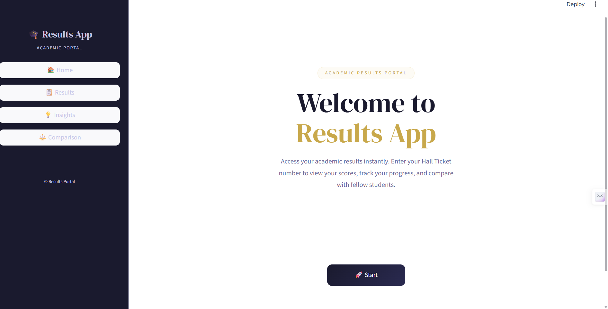 |
| Semester results | 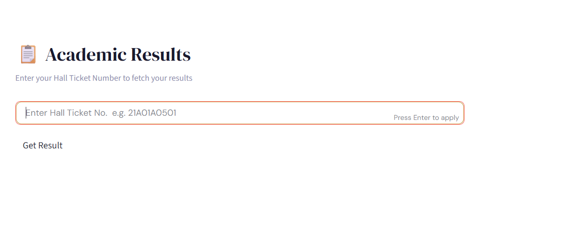 |
| Student comparison | 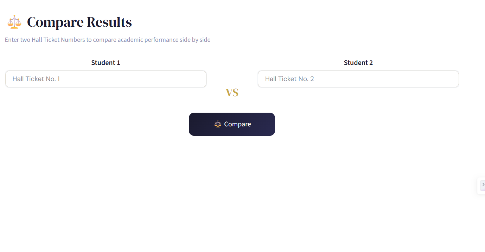 |
| PDF report export | 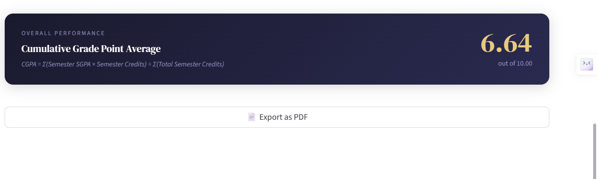 |
| Additional application view 1 | 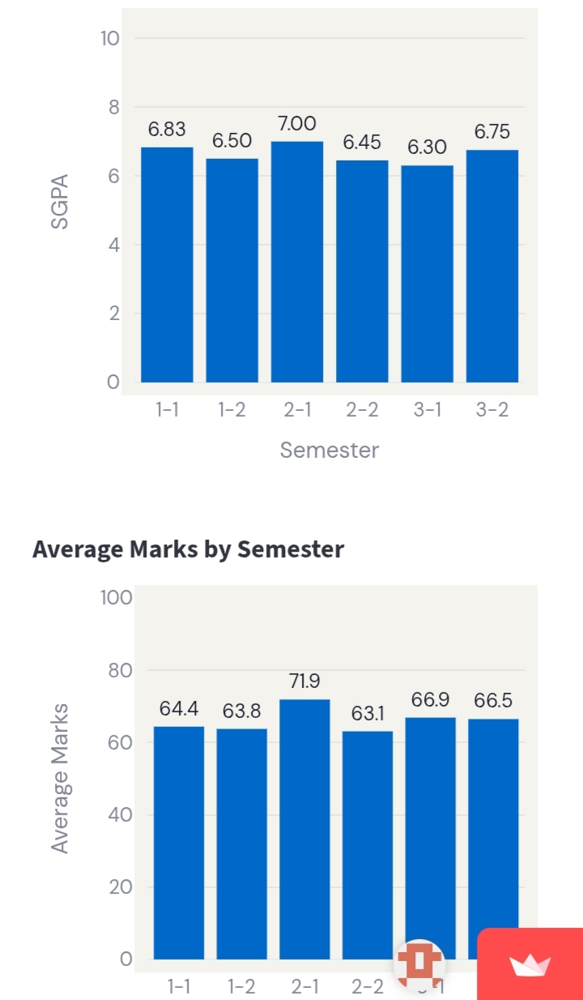 |
| Additional application view 2 | 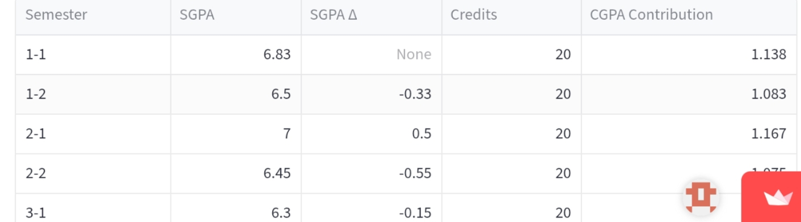 |
| Additional application view 3 | 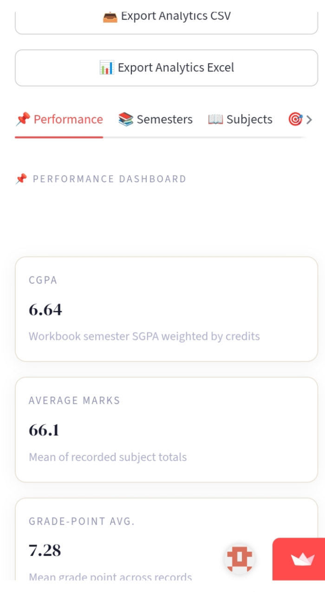 |
| Additional application view 4 | 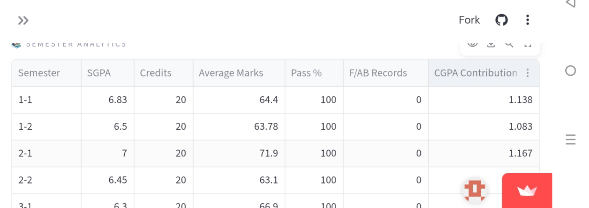 |
| Additional application view 5 | 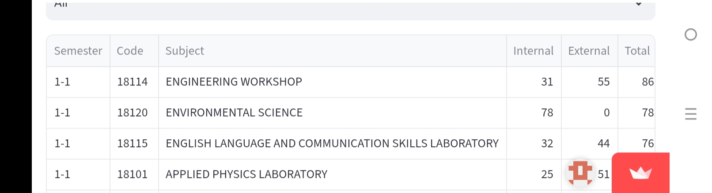 |
| Additional application view 6 | 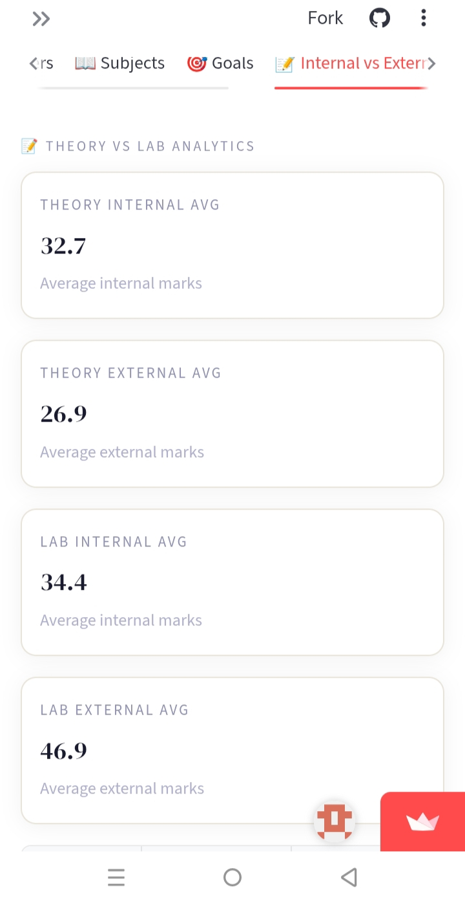 |
| Additional application view 7 | 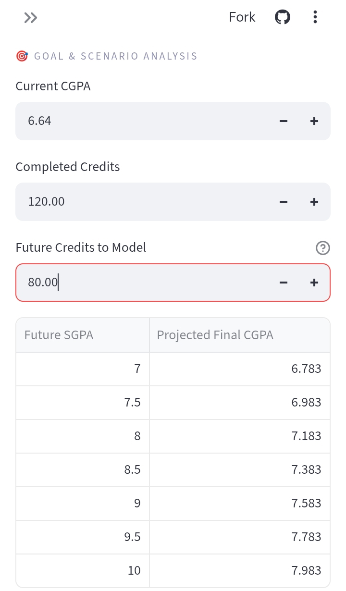 |

## How it works

```text
Student
  │
  ▼
Streamlit interface
  │
  ▼
Result lookup and analytics logic
  │
  ├──► Results and semester summaries
  ├──► Academic trends and comparisons
  ├──► CGPA goal / what-if calculations
  └──► Exports and PDF reports
  │
  ▼
Excel workbook (results.xlsx)
```

The Streamlit interface presents result and analytics workflows. Pandas processes the workbook data, OpenPyXL supports Excel handling, Plotly provides interactive visualizations, and ReportLab supports PDF report generation. Academic analytics helpers are separated into `academic_analytics.py`.

## Technology stack

| Layer | Technology |
|---|---|
| Language | Python 3.14 |
| Web interface | Streamlit |
| Data processing | Pandas |
| Excel handling | OpenPyXL |
| Interactive charts | Plotly |
| PDF reports | ReportLab |
| Data source | Excel workbook (`results.xlsx`) |
| Deployment | Streamlit Community Cloud |

## Academic calculations and data handling

### SGPA and CGPA

The app uses semester SGPA and credit information available in the workbook to support weighted academic calculations.

**Weighted CGPA = Σ(Semester SGPA × Semester Credits) / Σ(Semester Credits)**

### Grades and backlogs

Recorded grade values are used to distinguish passing grades from F/AB records for backlog-related analysis.

### Missing semesters

A missing semester is treated as missing data, not a score of zero. Semester-to-semester movement is calculated only when the recorded semesters are consecutive. For example, a comparison from 3-1 to 4-1 is not treated as a consecutive-semester change if 3-2 is absent.

### Goal planning

Future CGPA scenarios use the credits and SGPA assumptions supplied to the calculator. The app does not invent a remaining-credit total when the workbook does not provide one.

## Quick start

**Python version:** Use Python **3.14** for this project.

Check your installed version:

```bash
python --version
```

The output should begin with `Python 3.14`.

### 1. Clone the repository

```bash
git clone https://github.com/PrahitViraajReddy/Results.git
cd Results
```

### 2. Create a virtual environment

```bash
python -m venv .venv
```

Activate it:

**Windows**
```powershell
.venv\Scripts\Activate.ps1
```

**macOS / Linux**
```bash
source .venv/bin/activate
```

### 3. Install dependencies

```bash
python -m pip install --upgrade pip
pip install -r requirements.txt
```

### 4. Run the application

```bash
streamlit run ui.py
```

Streamlit will print a local URL in the terminal. Open that URL in your browser.

## Repository structure

```text
Results/
├── .devcontainer/                  # Development container configuration
├── academic_analytics.py            # Academic metrics and analysis helpers
├── images/                          # Application screenshots
├── results.xlsx                     # Semester-wise source workbook
├── requirements.txt                 # Python dependencies
├── ui.py                            # Main Streamlit application
└── README.md                        # Project documentation
```

## Data privacy and responsible use

Academic records can contain personal information. Use only data you are authorized to access, and avoid publishing real student records or hall-ticket details in public screenshots, repositories, or deployments. Before using the application with real student data, review the workbook contents and the access/privacy controls of the deployment.

## Engineering highlights

- Student-focused workflows across results, analytics, comparison, and CGPA planning
- Data processing for semester-wise academic records stored in Excel
- Academic metrics with explicit handling for missing semesters
- Comparison logic for common subjects and recorded semester performance
- Interactive visualizations and exportable reports
- Separation of analytics helpers from the main Streamlit interface

## Links

- **Live application:** https://academic-results.streamlit.app/
- **GitHub repository:** https://github.com/PrahitViraajReddy/Results

---

<div align="center">

Built with Python, Streamlit, and Pandas.

</div>
